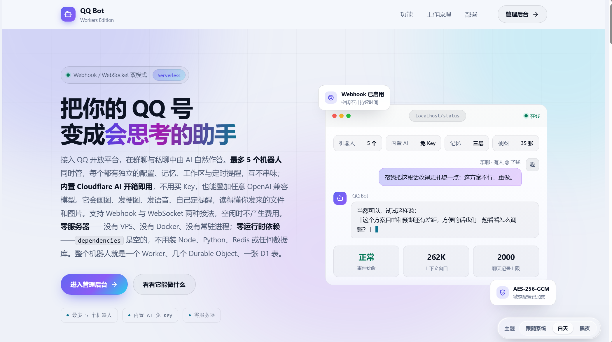
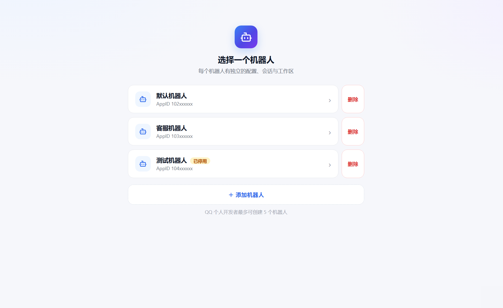
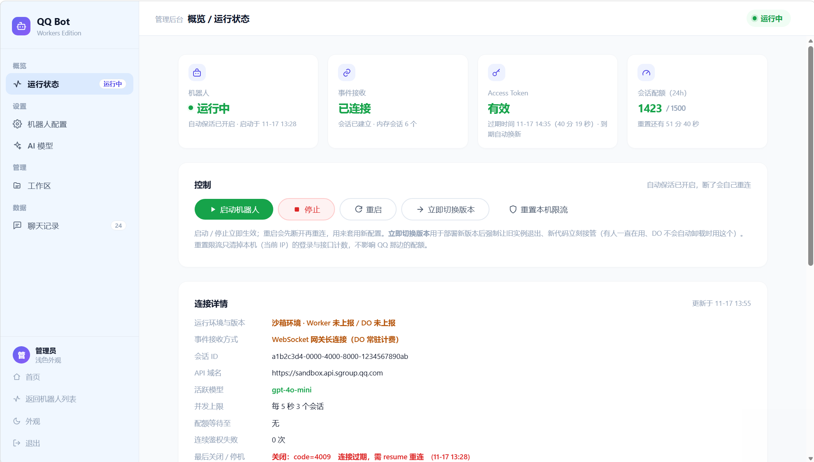

# QQ Bot CF

把 QQ 机器人跑在 **Cloudflare Workers + Durable Objects** 上：接入 QQ 开放平台，用内置 Cloudflare AI 或任意 OpenAI 兼容模型在群聊 / 单聊里自然对话，自带可视化管理后台。

- **运行时零依赖**：`dependencies` 为空，只有一个开发依赖 `wrangler`
- **最多 5 个机器人**：每个机器人独立配置、独立记忆、独立数据，一个部署全管
- **两种接入方式**：Webhook（推荐，空闲不计费）或 WebSocket 网关长连接
- **内置 AI 免 Key**：默认 Qwen 3.8 27B（262K 上下文、支持识图），不填任何 Key 就能聊



> 🔄 **建议及时 Sync fork**：上游会持续修复问题、补充配置项。在 GitHub 打开你的 fork 点 **Sync fork** 即可合并最新代码，Cloudflare 会自动重新构建部署，**密钥与数据都不会丢**。

---

## 目录

- [界面预览](#-界面预览)
- [部署](#-部署)
- [多机器人](#-多机器人)
- [事件接收方式](#-事件接收方式webhook-还是-websocket)
- [后台页面](#-后台页面)
- [常用指令](#-常用指令)
- [特性](#-特性)
- [架构](#-架构)
- [更新](#-更新)
- [常见问题](#-常见问题)
- [本地开发](#-本地开发)
- [图标与许可](#-图标与许可)
- [合规与免责](#-合规与免责声明)

---

## 🖼️ 界面预览

### 机器人列表 `/pick`

一个部署管 5 个机器人，每个都是普通一行——有独立的配置、会话和工作区，任何一个都能删。



### 运行状态 `/<AppID>/status`

连接状态、Token、会话配额、控制按钮与连接详情都在一屏；侧边栏底部有「返回机器人列表」。



---

## 🚀 部署

全程**不需要填任何 ID**：D1 库会自动查找，没有就创建。

### 1. 连接 GitHub

1. 打开 [Cloudflare 控制台](https://dash.cloudflare.com/) → **Workers & Pages** → **Create** → **Create Worker** → **Connect Git repository**
2. 授权 GitHub，选这个仓库（或先 fork 一份到自己账号），点 **Begin setup**
3. **把部署命令改成 `npm run deploy`**（默认的 `npx wrangler deploy` 会丢 D1 绑定）
4. 点 **Deploy**

部署完成会自动：建/找 D1 库 → 部署 Worker。之后站点会显示「尚未完成配置」页。

### 2. 补两个密钥

[Cloudflare 控制台](https://dash.cloudflare.com/) → 本 Worker → Settings → **Variables and Secrets** → Add，**类型选 Secret**：

| 名称 | 用途 | 备注 |
|---|---|---|
| `ADMIN_TOKEN` | 后台登录密码 | 16 位以上随机串，忘了直接改成新值即可 |
| `CONFIG_ENC_KEY` | 敏感配置的加密主密钥 | 16 位以上随机串，**加完不要改**，换了旧配置解不开 |

加完点 **Deploy** 生效。

### 3. 绑定自定义域名（必须）

**workers.dev 域名已全部禁用**（`preview_urls = false` + `workers_dev = false`）：每次部署的临时预览链接和 `qq-bot-cf.<你的子域>.workers.dev` 主地址都不会开启。原因：workers.dev 在国内大部分网络环境访问不稳定，而且等于多开一个公网入口。

所以**访问后台必须绑定自己的域名**。这个域名同时也是 Webhook 模式的回调入口（`https://你的域名/qq/webhook`）。

**前提**：域名已托管在**同一个 Cloudflare 账号**（NS 已切到 Cloudflare）。

**方法 A：控制台绑定（推荐）**

1. [Cloudflare 控制台](https://dash.cloudflare.com/) → **Workers & Pages** → 点开 `qq-bot-cf`
2. **Settings** → **Domains & Routes** → **Add** → **Custom domain**
3. 填子域名（如 `bot.example.com`）→ **Add domain**

Cloudflare 自动加 DNS 记录并签发证书，几分钟生效。绑定跟的是 Worker 本身，之后重新部署**不需要**重绑。

**方法 B：写进配置**

跑 `npm run setup`，第 4 步填域名，它会往 `wrangler.toml` 写入 `routes` 段；也可以手动加：

```toml
routes = [
  { pattern = "bot.example.com", custom_domain = true }
]
```

> 同一个域名只能给一个 Worker 用，绑定时 Cloudflare 会提示已有 DNS 记录会被替换。别绑到正在跑网站的主域名上，用专门的子域名（`bot.`、`qq.` 之类）。

### 4. 登录后台

1. 数据表会在 Worker 启动时自动建好（无需手动建表）
2. 打开 `https://你的域名/login`，用 `ADMIN_TOKEN` 登录
3. 进入机器人列表，点进第一个机器人，填 QQ AppID / Secret（未上线机器人开「沙箱环境」）
4. AI 部分开箱即用（内置 Cloudflare 模型不需要 Key）；想用外部模型再到「AI 模型」里添加

---

## 👥 多机器人

QQ 个人认证开发者最多创建 **5 个**机器人，本项目按这个上限提供统一管理，一个部署全管。

### 怎么用

1. 登录后先进入机器人列表：`/pick`
2. 点卡片进入对应机器人的后台，或点「添加机器人」填名称 / AppID / Secret
3. 每个机器人有自己的控制台地址，直接收藏也不会串
4. 想删哪个都行——**没有「默认机器人」这种删不掉的身份**，删光后会回到空列表，从头添加即可

### 控制台地址

```
/pick                    → 机器人列表（可增删）
/<AppID>/status          → 运行状态
/<AppID>/config          → 机器人配置
/<AppID>/ai              → AI 模型
/<AppID>/workspace       → 工作区（含定时任务）
/<AppID>/logs            → 聊天记录
```

- 机器人身份**由 URL 决定**并注入页面，物理上不可能误改其他机器人
- 未知 AppID 一律跳回 `/pick`，不会兜底到别的机器人
- 侧边栏有「返回机器人列表」

### 每个机器人独立什么

| 项目 | 是否独立 | 说明 |
|---|---|---|
| AppID / Secret | ✅ | 各自的 QQ 机器人凭证 |
| 系统提示词 / 人设 | ✅ | 可以是完全不同性格的机器人 |
| AI 模型列表与 Key | ✅ | 一个用内置 CF，另一个用外部模型也行 |
| 对话记忆 | ✅ | 记忆按机器人 + 按人隔离，不会串 |
| 聊天记录 | ✅ | 各看各的，互不可见 |
| 工作区 / 沙箱文件 | ✅ | 文件系统独立 |
| 定时提醒 | ✅ | 到点由各自的机器人发送 |
| 群列表与开关 | ✅ | 同一个群可以只让其中一个机器人回话 |

技术上是按机器人隔离 Durable Object 实例（`bot:<机器人>:<版本>`）+ 配置命名空间（`bot:<机器人>:<字段>`），没有「默认机器人」这种特殊身份，任何一个都能删。

> ⚠️ **本版不兼容旧版本数据**：配置只认 `bot:<机器人>:<字段>` 这种带前缀的键。从 3.20.1 之前的版本升级后，机器人列表会是空的，需要重新添加机器人并重填 AppID / Secret；旧的会话记忆与工作区不会再被读取。

### Webhook 回调地址（两种都可以）

多个机器人同时用 Webhook 时，有两种填法：

| 方式 | 地址 | 说明 |
|---|---|---|
| 共用 | `https://你的域名/qq/webhook` | 按 Ed25519 签名逐个比对，自动认出是哪个机器人 |
| 专用 | `https://你的域名/<AppID>/qq/webhook` | 地址本身指明了机器人，不依赖签名猜测 |

后台 Webhook 卡片会同时显示这两个地址，可一键复制。**机器人多的时候推荐用专用地址**，最不容易出意外。

---

## 🔀 事件接收方式：Webhook 还是 WebSocket

QQ 开放平台支持两种事件推送方式，**平台侧设的是哪种，机器人就必须用哪种收**。本项目会跟随平台设置，后台只做展示。

| | Webhook（推荐） | WebSocket 网关长连接 |
|---|---|---|
| 空闲计费 | **不产生 GB-s** | 约 10,800 GB-s/天 |
| 会话配额 | 不占用 | 占用（重连需 IDENTIFY 时扣） |
| 前提 | 需公网回调地址 | 配好 AppID / Secret 即可 |
| 断线补发 | 不涉及长连接 | 走 RESUME，漏的事件由网关补发 |

### 为什么计费差这么多

Cloudflare 对 `ws.accept()` 的 Durable Object **按整段连接时长计费**，而**出站 WebSocket 不支持 Hibernation API**（[官方文档](https://developers.cloudflare.com/durable-objects/examples/websocket-hibernation-server/)明确写了 "WebSocket Hibernation is unavailable for outgoing WebSocket use cases"）。

所以只要靠长连接收消息，`QQBotDO` 就得 24 小时待命：

- 一天约 **10,800 GB-s**（0.125 GB × 86400 秒）
- 免费额度 13,000 GB-s/天，占掉 **83%**
- 一个月约 **324,000 GB-s**

改成 Webhook 后这个对象不再持有连接，处理完事件就休眠，**持续时间≈0**。

### 怎么切换

**首次接入**：什么都不用做，默认走 WebSocket，配好 AppID / Secret 就能用。

**想改成 Webhook**（省计费）：

1. QQ 开放平台 → 你的机器人 → **开发设置 → 事件订阅**
2. 回调地址填后台上显示的那条（端口 80 / 443 / 8080 / 8443 均可）
3. 点保存，平台会发一次 `op=13` 校验请求，本项目用 Ed25519 私钥签名后自动返回
4. 校验通过后，到后台「机器人配置 → 事件接收方式」确认已切到 Webhook

> ⚠️ QQ 开放平台的「事件接收」记得**全部打开**，否则机器人收不到消息，看起来像 AI 不工作。

**改回 WebSocket**：在平台切回去之后，到后台点**「我在平台改成了 WebSocket」**。

### 切换不丢消息（宽限期）

平台切换事件订阅后，两条通道可能**短暂同时推送**（平台侧生效有延迟，网关长连接不会立刻断）。本项目做了两件事保证切换无缝：

- **宽限期**：收到 Webhook 推送后，先切内存模式，但**不立刻断开网关长连接**，让它在 60 秒宽限期内继续接收（可能还有事件补发），靠 `msg_id + msg_seq` 去重兜底；宽限期结束才回收连接，避免一直烧 GB-s
- **反向信号抑制**：宽限期内不因网关偶然吐一条 `READY`/`DISPATCH` 就来回改模式，防止切换震荡

后台「我在平台改成了 WebSocket」按钮会跳过宽限期立即生效（因为你已经明确改了平台）。

> **为什么改回需要手动点**：Webhook 模式下本对象根本不连网关，收不到任何 WS 事件，也就没有任何信号能自动发现平台已切回。这是信息层面的限制，不是偷懒。
>
> 反方向（改成 Webhook）可以自动发现——收到第一条推送就是确凿证据。

---

## 🖥️ 后台页面

| 页面 | 地址 | 能做什么 |
|---|---|---|
| 机器人列表 | `/pick` | 选择机器人、添加、删除（上限 5 个） |
| 运行状态 | `/<AppID>/status` | 连接状态、Token、配额、启停、重启、切换版本、运行日志 |
| 机器人配置 | `/<AppID>/config` | AppID/Secret、人设提示词、事件接收方式、群聊策略、入群欢迎 |
| AI 模型 | `/<AppID>/ai` | 内置 CF 能力开关、外部模型列表与优先级、生图与语音配置 |
| 工作区 | `/<AppID>/workspace` | 每个会话的任务 / 笔记 / 执行记录、定时提醒 |
| 聊天记录 | `/<AppID>/logs` | 会话列表与完整对话内容、系统事件 |

---

## 💬 常用指令

群里 @ 机器人后直接说，单聊直接发。**以下指令也都可以用自然语言表达**。

| 指令 | 作用 |
|---|---|
| `/画 一只橘猫，水彩风格` | 调生图模型出图并发送（也可以说「画一张…」） |
| `/梗图` / `/梗图 名字` | 随机 / 指定内置梗图 |
| `/表情` | 随机一个 emoji |
| `/语音 你好呀` | 合成语音消息发送 |
| `/工作 <任务>` | 交给工作区 AI 执行，可维护任务清单和笔记 |
| `/工作 列表` / `/工作 清空` | 查看 / 重置本会话工作区 |
| `/沙箱 <任务>` | 在隔离沙箱里干活（AI 可自己建文件、做多步任务） |
| `/沙箱 文件` | 列出沙箱里的文件（只有你能看到） |
| `/沙箱 查看 <路径>` | 在聊天里直接看文件内容 |
| `/沙箱 发送 <路径>` | 把文件作为附件发给你 |
| `/沙箱 清空` | 清空沙箱 |
| `/菜单` | 弹出按钮面板 |
| `/撤回` | 撤回机器人上一条消息 |
| `/帮助` | 显示指令帮助 |

**定时提醒不用指令**，直接说就行：

```
10 分钟后提醒我喝水
明天 8 点提醒我开会
每天 8:00 提醒我背单词
```

---

## ✨ 特性

### 对话与 AI

- **内置 Cloudflare AI，开箱即用**：默认对话模型 [`@cf/qwen/qwen3.8-27b`](https://developers.cloudflare.com/workers-ai/models/qwen3.8-27b/)——27B 视觉语言模型，**262K 上下文**，**支持识图**，不需要任何 API Key，走账号额度
- **多 AI 容错**：可再叠加多套外部 Base URL / Key / 模型，列表从上到下即优先级。前一个超时、网络错误、429 或 5xx 会先重试一次，仍失败自动切下一个，全挂才回兜底话术。内置 **21 个**一键预填：OpenAI、Google Gemini、xAI Grok、Groq、OpenRouter、Mistral、DeepSeek、通义千问、智谱 GLM、Kimi、火山方舟（豆包）、硅基流动、腾讯混元、讯飞星火、MiniMax、零一万物、阶跃星辰、百川智能、魔搭（免费额度）等
- **分层记忆**：每个会话一个独立的 `ChatDO`，记忆分三层存在它自己的 SQLite 里——**最近 N 条原文**逐字保真、**滚动摘要**（≤2 万字）覆盖中期脉络、**长期事实**（≤40 条）记住你是谁。原文全丢时仍能靠长期事实答出你的名字、城市、技术栈。重启、换版本都不丢
- **按人并行**：记忆按「人」隔离——单聊 `c2c:<用户>`、群聊 `group:<群>:u:<用户>`。群里不同人 @ 机器人各走各的 `ChatDO`，**互不等待、并行响应**，上下文不会串味
- **看图片**：把图片发给机器人，AI 能读懂并回答（内置 CF 模型与外部的视觉模型都支持）
- **Markdown 回复**：AI 回复含标题、列表、加粗、链接时按官方 Markdown 发送，排版更好（后台可开关）
- **图片回复**：AI 回复里的 Markdown 图片会自动上传转存后发出，上传失败降级为文字链接
- **单聊输入状态**：单聊里 AI 思考期间显示「正在输入…」
- **消息撤回**：`/撤回` 撤掉本会话最近一条机器人消息

### 生图与多媒体

- **AI 生图**：`/画 一只橘猫，水彩风格` 直接出图发送；也可以自然语言说「帮我画一只猫」。默认用内置 Cloudflare `flux-1-schnell`（**中文提示词会自动翻译成英文**再生成），也可以指向外部生图服务。内置 **11 个**模型预设：qwen-image-3.0-pro、qwen-image、wanx2.1-t2i-plus、seedream-4.0、doubao-seedream-3-0-t2i、cogview-4、dall-e-3、gpt-image-1.5、gpt-image-1、flux-schnell、nano-banana
- **内置梗图与表情**：**35 张**梗图存在 **D1** 里，部署时自动导入，不占 Worker 包体。`/梗图` 随机、`/梗图 名字` 指定，AI 也会在气氛合适时自己挑一张发
- **语音消息**：`/语音 你好呀` 默认用内置 **MeloTTS** 合成（**WAV 输出**，不需要额外 Key，走账号额度），也可以配置外部 OpenAI 兼容的 `/audio/speech`（MP3，支持响度增益）

### 文件与长任务

- **私有沙箱**：说「写一篇 3000 字关于秋天的文章，保存成 article.md 发我」，AI 会在**隔离的 AiDO** 里干活。它只能读写自己的虚拟文件系统（最多 5000 个文件 / 单文件 1.9MB / 单用户总量 1GB），**不能发消息、不能联网、不能碰其他 DO**。文件带真实修改时间
- **按人隔离**：单聊是 `c2c:<用户>`，群聊是 `group:<群>:u:<用户>`——同一个人在不同群的文件互相看不到，别人也看不到你的
- **自动收文件**：你直接发给机器人的文件（`.md` / `.py` / `.js` / `.json` / `.csv` / `.docx` / `.xlsx` 等）会按**原始文件名**自动存进你的私有目录，AI 也能读到全文再回答。二进制（`.so` / `.zip` / `.pdf`）会明确说读不了，不会瞎编
- **自动打包**：一次要发超过 3 个文件时自动打成 zip（纯 JS stored ZIP，上限 4MB），避免撞上 QQ 被动回复的条数限制
- **长任务后台执行**：生图、沙箱这类慢任务不阻塞同会话的其他消息。立即回执，完成后把结果和文件补发过来（超过 4 分钟则改走主动消息）

### 任务与提醒

- **AI 工作区（`/工作`）**：`/工作 帮我整理这周的待办` 交给独立的 `WorkDO` 执行，AI 可维护任务清单和笔记；**数据按会话隔离**。后台「工作区」页能看每个会话的任务 / 笔记 / 执行记录，并可一键清空
- **定时提醒**：直接说「10 分钟后提醒我喝水」「明天 8 点提醒我开会」「每天 8:00 提醒我背单词」，到点主动发消息，重复任务自动顺延。提醒存在 D1 里，跨重启、跨版本升级都不丢
- **提醒精度到秒**：由 `QQBotDO` 的 alarm 精确驱动，不靠轮询。新提醒入库时立即 `setAlarm` 到那一刻

### 群管理

- **群管理页**：集中管理机器人所在的群——群列表自动收集（收到群消息 / 被拉进群时记下，也可手动粘贴 openid），每个群可单独开关机器人回复（保存秒级生效）
- **群资料与禁言**：点开群可看官方群资料（群名 / 简介 / 分类 / 人数）和机器人群内状态，实时查询禁言状态，支持对成员禁言 / 解禁（10 分钟 ~ 30 天）
- **群管理权限**：机器人被授予群管理员后，AI 可在群里执行禁言 / 解禁 / 移出成员 / 入群审批。**仅群主和管理员可触发**，不能操作群主、自己、同级管理员；踢人需回复「确认」二次确认（3 分钟有效）；全员禁言未开放（官方 `global_rule` 只读）
- **入群欢迎**：新成员进群自动发欢迎语（支持 `{member}` 占位符 @ 新成员）；机器人被拉进新群也会打招呼

### 交互

- **按钮菜单**：`/菜单` 弹出带按钮的面板——指令按钮自动把内容填进输入框，跳转按钮直达项目主页；按钮发送失败自动降级为文字菜单
- **AI 工具调用**：AI 能按需调用内置工具——生成图片、发梗图、设置定时提醒、查本群资料 / 机器人状态 / 禁言状态（后台可开关）。工具走 `[TOOL]{...}` 协议；群资料类工具受官方白名单权限限制，报 `11253` 属正常
- **换配置即时生效**：后台改 AI 配置 / 人设提示词 / 生图模型，保存后立即热更新，不用重启

### 安全与隐私

- **密钥加密**：QQ Secret 与 AI Key 以 **AES-256-GCM** 加密后入库，后台**不回显明文**，只告诉你「是否已配置」
- **日志脱敏**：写日志前统一抹掉 `sk-` 开头的 Key、Bearer 令牌、32 位十六进制串和 JSON 里的 secret 字段
- **标识脱敏**：会话 openid 入库前先做 SHA-256 指纹，只留 8 位十六进制，原始 openid 不落库、不入日志
- **Webhook 验签**：回调请求走 Ed25519 验签（`X-Signature-Ed25519` + `X-Signature-Timestamp` + 原始 body），伪造推送会被 401 拒绝。**多个机器人各自的签名互不通用**
- **登录与接口限流**：登录 5 次 / 15 分钟，接口 120 次 / 分钟
- **CSP 与 CSRF**：页面使用 nonce 的严格 CSP；变更类请求统一校验 Origin
- **运行时依赖**：`dependencies` 为空，只有 `wrangler` 一个开发依赖

---

## 🏗️ 架构

```
QQ 开放平台
   │  Webhook（HTTP POST）或 WebSocket（网关长连接）
   ▼
Worker ── 登录 / 会话 / 限流 / Webhook 验签 / 按签名识别是哪个机器人
   │
   ├── QQBotDO      事件分发、消息队列、AI 调度（每个机器人 × 每个版本一个实例）
   ├── ChatDO       每会话一个：分层记忆 + 模型调用
   ├── WorkDO       每会话一个：工具执行 + /工作 任务清单
   ├── AiDO         每会话一个：隔离沙箱（文件系统）
   └── RateLimiter  按 IP：登录 / 接口限流
   │
   ├── D1  qq-bot-db    配置 / 聊天记录 / 提醒 / 梗图 / 群 / 工作区索引
   └── Workers AI       内置对话（qwen3.8-27b）/ 生图（flux）/ 语音（MeloTTS）
```

**为什么拆这么多 DO**：慢请求（带图最长 180 秒）不会阻塞其他会话，多个会话可并行。`QQBotDO` 只管收发和调度，实际的重活分散到各个 DO 里，互不干扰。

**多机器人怎么隔离**：`QQBotDO` 实例名是 `bot:<机器人名>:<版本>`，配置键是 `bot:<机器人名>:<字段>`，聊天记录等表都带 `bot_id` 列。所以同一个部署里，几个机器人彼此看不到对方的记忆、文件、记录和提醒。

---

## 🔄 更新

GitHub 上打开你的 fork → **Sync fork** → 合并上游，Cloudflare 会自动重新构建部署。

- 密钥、业务配置、聊天记录都**不会丢**
- 新版本部署后，旧 DO 实例会被新版本接管，**不需要手动重启**
- 若没 fork，直接 `git pull` 上游后 `npm run deploy` 即可

---

## ❓ 常见问题

**升级后机器人列表是空的？**

本版不兼容旧数据，属于预期行为：配置只认 `bot:<机器人>:<字段>` 这种带前缀的键，老版本存在无前缀键下的凭据不再被读取。

处理办法：在 `/pick` 点「＋ 添加机器人」，把 QQ 开放平台的 AppID / Secret 重新填一遍即可。旧的聊天记忆和工作区不会再被关联（数据仍留在库里，只是不再引用）。

**为什么必须用 `npm run deploy`？**

`wrangler deploy` 会按配置文件**整体覆盖** Worker 的绑定，配置里没声明的会被清掉——这就是「更新一次代码，数据库连接就没了」的根因。

但 `database_id` 每个账号不同，不能写死进仓库。所以仓库里的 `wrangler.toml` 故意不带 D1 段，由 `npm run deploy` 在部署时自动生成一份带绑定的配置再部署。

| 命令 | D1 绑定 |
|---|---|
| `npm run deploy` | ✅ 自动处理 |
| `npx wrangler deploy` | ❌ 被清掉 |

**后台显示「D1 数据库没有绑定」/ 登录报「服务器内部错误」**

部署命令还是 `npx wrangler deploy`。改成 `npm run deploy` 重新部署即可。数据不会丢，只是绑定被清空了。

**密钥必须存成 Secret 吗？**

必须。Cloudflare 把「环境变量」和「Secret」分开处理：

- **普通变量（Text）**：每次 `wrangler deploy` 都会按配置整体覆盖，控制台手动加的会被清空
- **Secret（加密变量）**：deploy 不会删，除非手动 `wrangler secret delete <key>`

配置里已加 `keep_vars = true` 兜底，但正确做法仍是选 Secret。

**提示「加密主密钥需要处理」**

`CONFIG_ENC_KEY` 和库里已加密的数据对不上（多半是换了值）。这时打开任何页面都会被引导到 `/recover`，**需要先输入 `ADMIN_TOKEN` 验证身份**才会显示恢复步骤。验证后可以把 `CONFIG_ENC_KEY` 改回最初的值，也可以换新值后点「清空旧配置」重新开始——清空只删 QQ Secret、AI Key 和 AI 列表，聊天记录、登录会话和对话行为设置都保留。

**部署报错 `10021 binding DB must have a valid database_id`**

部署命令被改回了 `npx wrangler deploy`。改回 `npm run deploy`。

**网关一直连不上，关闭码 4914**

机器人未上线，只能连沙箱。到后台打开「沙箱环境」。（Webhook 模式不登录网关，不会出现这个错误。）

**Durable Object 一直占用 GB-s 怎么办？**

`QQBotDO` 走 WebSocket 长连接时会被整段连接时长计费（约 10,800 GB-s/天）。按上面「改成 Webhook」把连接换掉即可，之后这个对象只在收到消息时短暂运行，空闲不产生持续时间。

**「会话配额已用尽」**

QQ 官方限制每 24 小时可新建的 session 数（默认 1500）。等配额重置即可，程序会自动重试。

**Access Token 是什么？会过期吗？**

它是调用 QQ **HTTP 接口**的通行证（发消息、查群、禁言、撤回、上传媒体都要它），和「怎么收消息」无关，所以两种模式都显示。

- 不是你手填的，是程序拿 AppID + Secret 自动换的
- 有效期约 2 小时，**用到时发现快过期就当场换新**（没有后台定时任务）
- 会提前 30 秒视为过期，避免发消息途中失效
- 换到后落盘复用，Webhook 模式下新实例醒来直接用，不会每条消息都换一次
- 并发调用会合并成一次请求；QQ 若返回同一个 token，会保留原到期时刻，避免「假续期」

**为什么只有某个机器人能收 Webhook？**

先看这个机器人的「运行状态 → 连接详情」：

- **事件接收方式**是否为 Webhook
- **最后收到推送**是否为空

如果「最后收到推送」一直为空，说明事件根本没到 Worker，属于 QQ 平台侧的**回调地址或事件订阅**问题（记得把「事件接收」全部打开）。

如果确认平台在推送但还是不行，改用**每个机器人的专用回调地址** `https://你的域名/<AppID>/qq/webhook`——地址本身指明了机器人，不依赖签名识别，最稳。

**多个 AI 是怎么切换的？**

「AI 模型」里每条配置都是一套独立的 Base URL + API Key + 模型，列表从上到下就是优先级。机器人先请求内置 CF（如果开着），再按顺序试外部模型，遇到超时、网络错误、429 或 5xx 会先重试一次，仍然失败就换下一个，全部失败才回「出了点小状况」。停用的条目不参与。聊天记录里的「模型」标签会写明是哪一套答的。

**聊天记录里存的是什么？会保存 QQ 的 openid 吗？**

不会。持久化的数据分三处，都不含原始 openid：

- **D1 `chat_log`**：问题原文、回答原文，`scope_id` / `user_id` 存的是 openid 的 SHA-256 指纹（8 位十六进制）。系统事件也记在这张表里。图片 / 梗图 / 语音记成占位文本；只留最近 2000 条
- **D1 `memes`**：内置梗图（压缩后的 JPEG base64）与名称 / 描述，部署时从 `assets/memes` 自动导入
- **各 DO 的 SQLite**：`ChatDO` 存对话上下文（最近若干轮 + 摘要 + 长期事实），`AiDO` 存沙箱文件，`WorkDO` 存任务与笔记。重启、换版本都不会丢

**沙箱里的文件我能下载吗？**

能。AI 生成文件后会自动作为附件发给你，也可以 `/沙箱 发送 <路径>` 手动要。超过 3 个文件会自动打成 zip。

---

## 🔧 本地开发

```bash
npx wrangler login    # 首次
npm run deploy        # 自动建库 + 部署（建表由 Worker 启动时自动完成）
npm run dev           # 本地开发（自动生成带 D1 绑定的配置，默认 127.0.0.1:8787）
npm run seed:memes    # 把内置梗图导入本地 D1
npm run tail          # 看线上实时日志
```

`npm run setup` 只剩「选账号 / 绑自定义域名」的用途，直接 `npm run deploy` 也能跑通。

---

## 🎨 图标与许可

项目图标、后台侧边栏图标与网站图标（favicon）使用 [Lucide](https://lucide.dev) 的 `bot` 图标，采用 **ISC License**——允许商用、修改与再分发，只需保留版权与许可声明：

- 版权：Copyright (c) for portions of Lucide are held by Cole Bemis 2013-2022 as part of Feather (MIT). All other copyright (c) for Lucide are held by Lucide Contributors 2022.
- 许可全文：<https://github.com/lucide-icons/lucide/blob/main/LICENSE>
- favicon 的渐变底色与白色描边是在原图标基础上做的样式处理，仍遵循同一许可。

---

## ⚠️ 合规与免责声明

本项目仅在**遵守 Cloudflare 平台与 QQ 开放平台规定**的前提下提供，供学习、研究和合法的个人使用：

- **Cloudflare**：[服务条款](https://www.cloudflare.com/website-terms/) 与[可接受使用政策](https://www.cloudflare.com/aup/)——不得用于攻击、扫描、钓鱼、垃圾信息、挖矿、绕过配额或其它违规用途
- **QQ 开放平台**：须使用[官方开放平台](https://q.qq.com)注册并通过审核的机器人，遵守其运营规范、接口权限与频率限制；不得用于骚扰用户、传播违法违规内容、伪造身份或规避平台风控
- **第三方服务**：AI 模型、生图、图片存储等均需遵守对应服务商条款

**请勿将本项目用于任何违法犯罪活动。** 项目作者不对使用者的行为及由此产生的后果负责；因违规使用导致的服务封禁、账号处罚或法律责任，由使用者自行承担。
